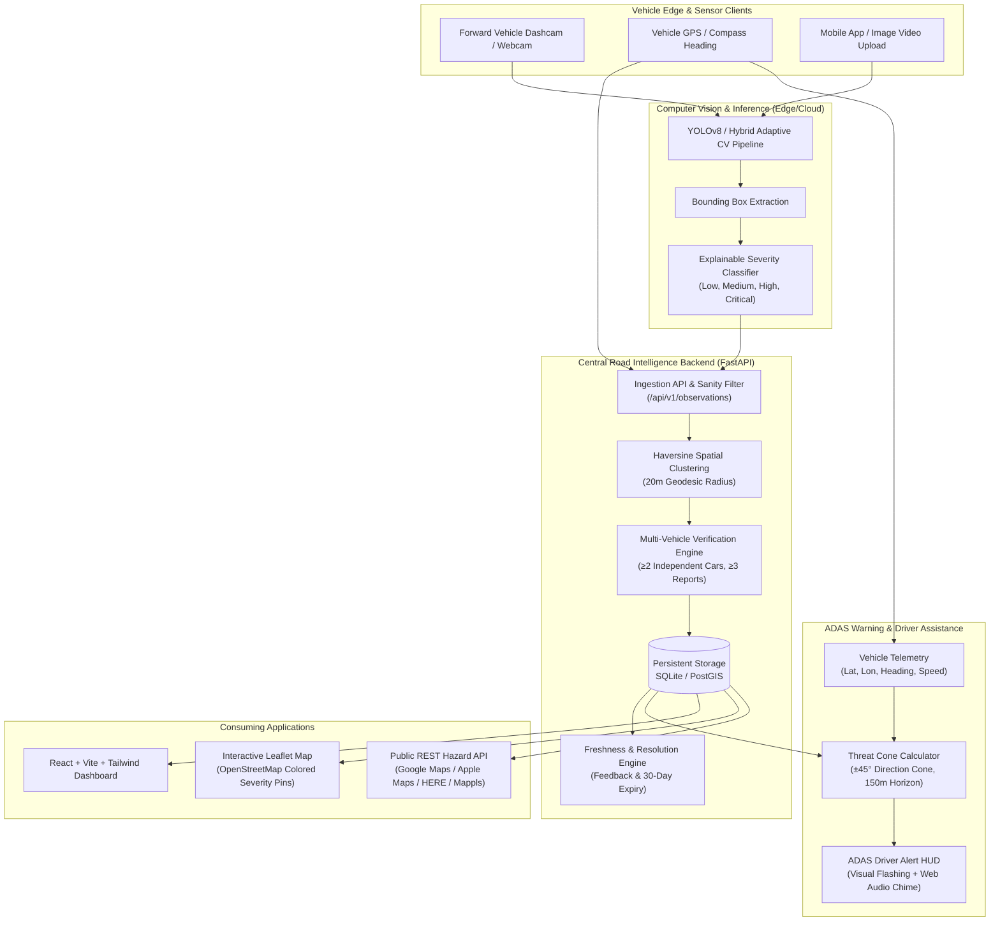

# AI Pothole Detection and Road Intelligence System
### Autonomous ADAS Hazard Perception & Crowdsourced Road Network

An end-to-end college minor project built by a B.Tech CSE (AI/ML) student for real-time computer vision pothole detection, spatial clustering, multi-vehicle crowdsourced verification, interactive OpenStreetMap visualization, and vehicle in-cabin ADAS driver warnings.

---

## 1. System Architecture



---

## 2. Core Capabilities

1. **AI Computer Vision Inference:**
   - Real-time frame processing via Ultralytics YOLOv8 architecture and OpenCV adaptive edge filters.
   - Outputs normalized bounding boxes `(x, y, w, h)`, confidence scores, and Base64-annotated overlays.
2. **Explainable Visual Hazard Severity:**
   - Distinguishes carefully between measured pixel properties and estimated engineering metrics.
   - Computes relative pothole frame area ($A = \frac{\text{width} \times \text{height}}{\text{frame\_width} \times \text{frame\_height}}$):
     - **Low:** $A < 1.8\%$ of road frame (minor surface crack/depression)
     - **Medium:** $1.8\% \le A < 4.8\%$ (moderate pothole)
     - **High:** $4.8\% \le A < 9.5\%$ (hazardous road cavity)
     - **Critical:** $A \ge 9.5\%$ (major vehicle-damaging road crater)
   - *Note:* Monocular camera visual estimate, not uncalibrated physical millimeter depth.
3. **GPS Geotagging & Spatial Deduplication:**
   - Great-circle geodesic distance using Haversine formula.
   - Groups observations within a **20-meter cluster radius** into persistent Road Hazard records.
   - Rolling weighted spatial average coordinates for accurate hazard pinpointing.
4. **Multi-Vehicle Verification Consensus:**
   - Rejects consecutive duplicate video frames from the same vehicle within 30 seconds.
   - A hazard starts as **Provisional**. It is promoted to **Verified** once confirmed by **$\ge 2$ independent pseudonymous vehicles** across $\ge 3$ distinct observations.
5. **Interactive Leaflet Road Map:**
   - OpenStreetMap tile rendering.
   - Color-coded severity pins (Emerald Green, Amber, Orange, Bright Red).
   - Real-time filters (by severity, verification state), hazard inspection drawer, and live hazard counts.
6. **ADAS Driver Threat Cone & In-Cabin Alert HUD:**
   - Calculates geodesic distance and initial compass bearing to upcoming hazards.
   - Evaluates angular deviation: $|\text{vehicle\_heading} - \text{bearing}| \le 45^\circ$.
   - Triggers audio-visual alerts (Emergency Deceleration / Reduce Speed / Caution) with distance countdown meter and Web Audio synthesized chimes.
7. **Documented Public REST API:**
   - Clean OpenAPI / Swagger interactive documentation at `/docs`.
   - Bounding box queries, nearby radius queries, driver feedback (`confirm`/`clear`), and CSV export.

---

## 3. Technology Stack

- **Backend:** Python 3.11, FastAPI, SQLAlchemy, SQLite (with spatial indexing / PostGIS compatible), Uvicorn.
- **Computer Vision & ML:** OpenCV, NumPy, PyTorch, Ultralytics YOLOv8.
- **Frontend:** React 18, TypeScript, Vite, Tailwind CSS, Leaflet, Lucide Icons, Web Audio API.
- **Testing:** Pytest, HTTPX, FastAPI TestClient (14 automated tests passing).

---

## 4. Local Setup Guide (Windows)

### Prerequisites
- Python 3.11+
- Node.js 18+ and npm

### Step 1: Clone and Enter Project Directory
```powershell
cd "d:\minor project"
```

### Step 2: Set Up Backend
```powershell
# Create Python virtual environment
python -m venv backend\.venv

# Activate virtual environment
.\backend\.venv\Scripts\Activate.ps1

# Install dependencies
pip install -r backend\requirements.txt
```

### Step 3: Set Up Frontend
```powershell
cd frontend
npm install
cd ..
```

### Step 4: Seed Initial Demonstration Data
```powershell
& ".\backend\.venv\Scripts\python.exe" scripts\seed_database.py
```

### Step 5: Run Automated Tests
```powershell
& ".\backend\.venv\Scripts\python.exe" -m pytest backend/tests
```

---

## 5. Running the Application

### Option A: Using Helper Windows Scripts
Double-click or run from PowerShell:
1. `scripts\run_backend.bat` -> Starts FastAPI at `http://127.0.0.1:8000`
2. `scripts\run_frontend.bat` -> Starts React Vite UI at `http://localhost:5173`

### Option B: From Command Line

**Terminal 1 (Backend):**
```powershell
cd "d:\minor project"
.\backend\.venv\Scripts\Activate.ps1
uvicorn backend.app.main:app --host 0.0.0.0 --port 8000 --reload
```

**Terminal 2 (Frontend):**
```powershell
cd "d:\minor project\frontend"
npm run dev
```

Open your browser to: **`http://localhost:5173`**  
Open API Swagger Docs to: **`http://127.0.0.1:8000/docs`**

---

## 6. How to Run Key User Workflows

### 1. Run an Image or Video Frame through the AI Model
1. Open the web dashboard at `http://localhost:5173` and click **Live Detection**.
2. Drag-and-drop any road image (or click **Activate Camera Stream** to test via device webcam).
3. Optionally adjust GPS coordinates or click **Sync Device Browser GPS**.
4. Click **Run Pothole Detection**.
5. The view displays the annotated frame with color-coded bounding boxes, confidence score, visual area percentage, and inference latency in milliseconds.
6. The detection is automatically clustered and persisted into the road hazard database.

### 2. View Detected Potholes on the Interactive Map
1. Click the **Hazard Map** tab in the navigation bar.
2. Filter markers by severity (Critical, High, Medium, Low) or verification status (Verified, Provisional).
3. Click any pin to open the **Hazard Details Drawer**, inspecting the total observations count, contributing vehicles, and explainable visual features.
4. Test driver feedback by clicking **Confirm Active** or **Report Repaired**.

### 3. Simulate a Vehicle Report & See the ADAS Driver Warning
1. Click the **ADAS Simulator** tab.
2. Click **Start Drive Track** to begin automated simulated vehicle playback along the arterial corridor.
3. Observe the vehicle moving on the map towards a verified hazard with its 150m radar sensing cone.
4. As the vehicle approaches within warning distance, the **ADAS Warning HUD** activates:
   - Visual flashing alert: **CRITICAL: Severe pothole 35m ahead**
   - Web Audio synthesizer plays urgent ADAS audio warning chime
   - Displays recommended driver action: *“EMERGENCY DECELERATION: Apply brakes smoothly, keep 2 hands on steering wheel.”*
5. Try adjusting the **Speed** and **Heading Compass** sliders to see directional suppression (e.g. driving away from the hazard turns alerts off).

### 4. Evaluate AI Model Metrics
Run the evaluation benchmark:
```powershell
& ".\backend\.venv\Scripts\python.exe" scripts\evaluate_model.py
```
Outputs:
- Ground Truth comparison across diverse lighting/asphalt scenarios
- Precision, Recall, F1-Score, and Estimated mAP@0.50
- Mean inference latency (FPS)

### 5. Test the REST API with cURL
```bash
# Query verified hazards
curl -X GET "http://localhost:8000/api/v1/hazards?status=verified&limit=5"

# Query hazards nearby vehicle location
curl -X GET "http://localhost:8000/api/v1/hazards/nearby?lat=28.5385&lon=77.3940&radius_m=1000"

# Ingest an observation
curl -X POST "http://localhost:8000/api/v1/observations" \
  -H "Content-Type: application/json" \
  -H "X-API-Key: road-hazard-api-key-2026" \
  -d '{"device_id":"veh-test-car","latitude":28.5388,"longitude":77.3944,"confidence":0.89,"severity":"high","area_ratio":0.06,"source_type":"dashcam"}'
```

---

## 7. Implementation Boundary & Integrity Disclosure

| Capability | Status in this Prototype | Notes / Production Pathway |
| :--- | :--- | :--- |
| **Computer Vision Pothole Detection** | **Fully Implemented** | Real OpenCV adaptive edge and Ultralytics YOLOv8 inference pipeline. Supports image, video snapshots, and live webcam feeds. |
| **Explainable Severity Estimation** | **Fully Implemented** | Explainable visual relative area ($A$) ratio. Clearly labeled as a visual estimate rather than depth sensor measurement. |
| **Spatial Deduplication & Verification** | **Fully Implemented** | Geodesic Haversine clustering within 20m. Independent vehicle device ID consensus prevents repeated frame inflation. |
| **Interactive Map & Dashboard** | **Fully Implemented** | React + Vite + Tailwind + Leaflet with live OpenStreetMap tiles and custom color-coded hazard markers. |
| **ADAS Threat Warning Calculation** | **Fully Implemented** | Geodesic bearing and heading cone calculation ($\pm 45^\circ$) with audio/visual HUD alerts. |
| **Vehicle Telemetry Input** | **Simulated & Browser GPS** | Uses browser geolocation or simulated route playback. Production requires vehicle CAN-bus/OBD-II gateway integration. |
| **Direct Vehicle Actuator Braking** | **Intentionally Excluded** | Driver warning alerts are informational only. Monocular prototypes must never override safety-critical braking or steering actuators. |
| **Commercial Map Provider Sync** | **Documented REST API** | Implements standard GeoJSON/REST endpoints. Commercial integration (Google Maps / Apple Maps) requires official OEM data partner agreements. |

---

## 8. College Project Evaluation Summary

- **Course:** B.Tech Computer Science & Engineering (AI/ML)
- **Project Title:** AI Pothole Detection and Road Intelligence System
- **Core Value:** Bridges raw computer vision perception with automotive ADAS alert logic and municipal road maintenance data aggregation.
